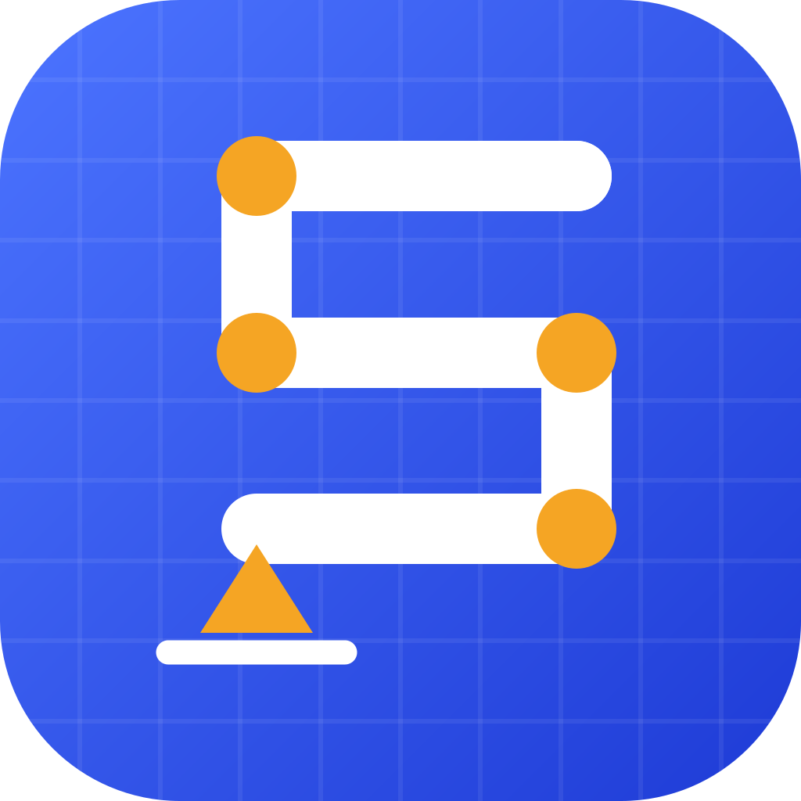

<p align="center">
  
</p>

<h1 align="center">Sibot</h1>

<p align="center">
  Structural analysis and design on phones and tablets.<br>
  2D and 3D frames, plates, reinforced concrete, steel, timber, masonry and
  foundations — Eurocodes and BAEL, in English and French.
</p>

<p align="center">
  <a href="https://github.com/VagontraCode/sibot/actions/workflows/ci.yml"></a>
  <a href="https://github.com/VagontraCode/sibot/releases/latest"></a>
</p>

> **Beta — verify independently.** Sibot is engineering software. Every
> module is tested against hand calculations and published references, but
> results must be checked by a qualified engineer before use.

## What it does

**One model, your analyses, design from the results** — the RSA way:

- **Model** in 3D from an empty space, the building generator, a 2D frame
  or a DXF drawing: draw on working planes, end releases, supports and
  springs, copy / array / mirror, multi-selection, plane frames.
- **Load** with cases, partial / trapezoidal and point loads, your own
  combinations (EN 1990 / BAEL generated, then edited).
- **Analyse** with the list of analyses you choose: static, modal
  (Lanczos), response spectrum (EN 1998-1 or PS92, accidental torsion),
  buckling (αcr) and P-Δ.
- **Design** members in groups (RC, steel EC3, timber EC5) with a
  utilisation table and colour map, or send any member or support to a
  detailed calculator (beam section, column, steel, timber, footing) —
  linked back to the model.
- **Report**: result tables with CSV export, PDF calculation notes, `.sibot`
  and DXF exchange.

Also: plates (slabs, rafts), continuous beams, footings, retaining walls,
pile caps, slope stability (Bishop, Janbu), wind and snow (with French
regions), seismic lateral forces, masonry walls, timber connections.

Measured on a low-end phone (Nokia G100): see
[docs/PERFORMANCE.md](docs/PERFORMANCE.md). Plans: [docs/ROADMAP.md](docs/ROADMAP.md).

## Install

Download the latest APK from
[Releases](https://github.com/VagontraCode/sibot/releases/latest):
`sibot-x.y.z-arm64-v8a.apk` for most phones, `sibot-x.y.z.apk` if unsure.
Check it against `SHA256SUMS.txt`.

## Development

Flutter 3.47 (Dart 3.10+). The calculations live in a pure-Dart package,
`packages/sibot_engine`, tested on its own.

```sh
flutter pub get
flutter test                                   # app + screen smoke tests
(cd packages/sibot_engine && dart test)        # engine
flutter run
```

Useful extras:

```sh
SIBOT_SHOTS=build/shots flutter test test/screens_smoke_test.dart   # screenshots
flutter test tool/generate_icons_test.dart                          # regenerate all icons from the logo
flutter drive --profile --driver=test_driver/integration_test.dart \
  --target=integration_test/perf_test.dart -d <device>              # on-device benchmark
```

The logo is drawn by `paintSibotLogo` in `lib/ui/widgets/brand.dart`; the
icon generator renders the Android (adaptive and themed), iOS, web and
Windows icons from it.

## Releases

CI runs on every push and pull request (format, analyze, engine and app
tests, Android build). A release is published by pushing a version tag:

```sh
git tag v0.2.0
git push origin v0.2.0
```

The release workflow tests again, then builds the signed APKs (per ABI and
universal), the App Bundle for Google Play and the web build, verifies the
signature, and attaches everything with SHA-256 checksums.

### Signing

Release builds are signed with the upload key in
`android/upload-keystore.jks`, described by `android/key.properties`. Both
are git-ignored: **keep a backup of them outside the repository** — without
the key, updates cannot be published for the same app.

For CI, add these repository secrets (Settings → Secrets and variables →
Actions):

| Secret | Value |
|---|---|
| `SIBOT_KEYSTORE_BASE64` | `base64 -w0 android/upload-keystore.jks` |
| `SIBOT_KEYSTORE_PASSWORD` | `storePassword` from `android/key.properties` |
| `SIBOT_KEY_PASSWORD` | `keyPassword` from `android/key.properties` |
| `SIBOT_KEY_ALIAS` | `upload` |

Without the keystore, local release builds fall back to the debug key; the
release workflow refuses to publish an unsigned build.
